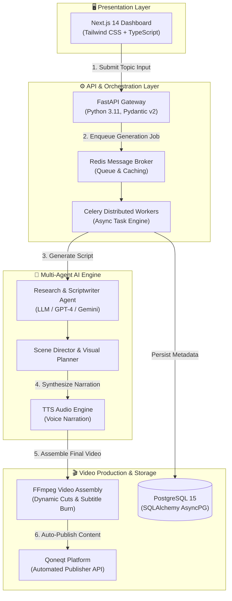

# Qoneqt AI Content Factory 🚀

> **Hackbriven National-Level Hackathon (Ahmedabad) Project • Team Leader: Prachi Zala**  
> An automated, end-to-end content production pipeline that generates short-form videos from raw topic inputs and publishes them directly to the **Qoneqt** platform.

[](https://github.com/prachizala)
[](https://github.com/prachizala)
[](https://fastapi.tiangolo.com/)
[](https://nextjs.org/)
[](https://www.docker.com/)
[](LICENSE)

---

## 🏗 Repository Layout

```text
qoneqt-ai-content-factory/
├── frontend/             # Next.js 14 App Router, TypeScript, Tailwind CSS, Lucide icons
├── backend/              # Python 3.11, FastAPI, Pydantic v2, SQLAlchemy 2.0 / AsyncPG
├── workers/              # Celery task queue definitions powered by Redis
├── ai/                   # LLM research, scriptwriter, and scene director modules
├── video_engine/         # FFmpeg video assembly, subtitle burn-in, audio mixing
├── integrations/         # Qoneqt API publisher client
├── database/             # PostgreSQL async connection, SQLAlchemy models & migrations
├── docker-compose.yml    # Multi-container orchestration specification
├── .env.example          # Environment variables template
└── README.md             # Project documentation
```

---

## ⚡ Tech Stack Overview

- **Frontend UI:** Next.js 14 (App Router), TypeScript, Tailwind CSS, Lucide Icons.
- **Backend API:** FastAPI (Python 3.11), Pydantic v2, uvicorn.
- **Task Queue & Broker:** Celery + Redis.
- **Database:** PostgreSQL 15 + SQLAlchemy 2.0 (AsyncPG) + Alembic migrations.
- **Video Assembly Engine:** FFmpeg CLI with custom audio mixer and subtitle burner.
- **AI Integrations:** OpenAI GPT-4 / Google Gemini API, Text-to-Speech (TTS), Image Generation.
- **Publishing Client:** Native Qoneqt REST API publisher integration.

---

## 🏛️ System Architecture



> 📊 **Hackathon Presentation Deck:** Open [`PPT.html`](PPT.html) directly in any browser to review the complete slide deck prepared for the Hackbriven hackathon evaluation committee.

---

## 🚀 Quick Start (Docker Compose)

### 1. Clone & Configure Environment Variables
Copy `.env.example` to `.env` and fill in your API keys:

```bash
cp .env.example .env
```

### 2. Boot Service Stack
Run Docker Compose to build and start all 5 services:

```bash
docker compose up --build
```

### 3. Access Service Endpoints

| Service | Port | Endpoint URL | Description |
| :--- | :--- | :--- | :--- |
| **Next.js Frontend** | `3000` | [http://localhost:3000](http://localhost:3000) | Dashboard UI for video generation pipeline |
| **FastAPI Backend** | `8000` | [http://localhost:8000/docs](http://localhost:8000/docs) | Interactive OpenAPI documentation |
| **Backend Healthcheck**| `8000` | [http://localhost:8000/health](http://localhost:8000/health) | System health status route |
| **PostgreSQL Database**| `5432` | `localhost:5432` | Relational database instance |
| **Redis Cache/Broker** | `6379` | `localhost:6379` | Celery message queue broker |

---

## 🛠 Local Development Setup (Without Docker)

### Backend & Celery Worker
```bash
# Create virtual environment
python -m venv venv
source venv/bin/activate  # On Windows: venv\Scripts\activate

# Install dependencies
pip install -r backend/requirements.txt

# Run FastAPI Server
uvicorn backend.main:app --reload --port 8000

# Run Celery Worker (in a separate terminal)
celery -A workers.celery_app worker --loglevel=info
```

### Frontend UI
```bash
cd frontend
npm install
npm run dev
```

---

## 🧪 Service Health & Verification

Verify the system status via CLI or browser:

```bash
curl http://localhost:8000/health
```

Expected JSON response:
```json
{
  "status": "healthy",
  "service": "qoneqt-ai-content-factory-backend",
  "version": "1.0.0",
  "environment": "development"
}
```
